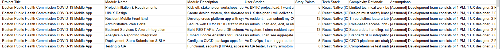
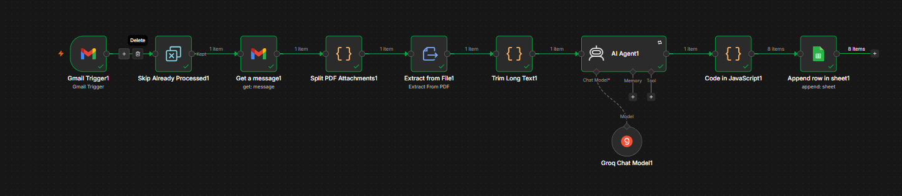

# 📄 RFP Analyzer: n8n Workflow

An automated RFP assistant that watches your Gmail for incoming Requests for Proposal, reads the attached PDF, and uses an LLM acting as a Solutions Architect to turn it into a sprint-ready estimate (modules, user stories, story points, assumptions and risks) logged straight to Google Sheets.

---

## 🚀 Just Want to See It in Action?

**No coding needed to try it.** Once the workflow is imported and active, just email yourself:

1. Subject containing `RFP`, `Request for Proposal` or `Tender`
2. A PDF attached

Within about 5 minutes, a structured backlog appears in your Google Sheet, one row per module.

---

## ✨ Features

- **Email Trigger**: Watches Gmail for RFP / Tender emails with PDF attachments, checked every 5 minutes.
- **Duplicate Protection**: Remembers processed emails, so nothing is analyzed twice.
- **Multi-PDF Support**: Every PDF in an email is processed separately.
- **Smart Trimming**: Jumps to the scope-of-work section and skips legal and submission boilerplate, so the model sees the requirements that matter.
- **AI Analysis**: Powered by Groq (`gpt-oss-120b`), producing strict JSON with modules, user stories, Fibonacci story points, assumptions and risks.
- **Safe Parsing**: Story points are snapped to the Fibonacci scale in code, and malformed model output raises a clear error instead of failing silently.
- **Google Sheets Logging**: One clean row per module, ready for SOW and sprint planning.

---

## 💬 How to Use

### Analyze an RFP
```
To:       your Gmail account connected to the workflow
Subject:  RFP - Mobile App Development
Attach:   rfp.pdf
```
That's it. The workflow picks it up on its next poll.

### What You Get in the Sheet

| Column | Meaning |
|---|---|
| Project Title | Name of the project from the RFP |
| Module Name / Description | A functional block for sprint planning |
| User Stories | Core stories for that module |
| Story Points | Fibonacci estimate (1, 2, 3, 5, 8, 13, 21) |
| Tech Stack | Suggested stack |
| Complexity Rationale | Why that estimate |
| Assumptions | Items the RFP did not state, marked `[Assumed]` |
| Risks | High-risk factors for delivery |

---

## 📊 Sample Output

Tested on a public RFP: Boston Public Health Commission, Mobile App Development (ITS-002-23).

```
Boston Public Health Commission COVID-19 Mobile App

 Module                                   Points
 ────────────────────────────────────────────────
 Project Initiation & Requirements           5
 UI/UX Design                                8
 Resident Mobile Front-End                  13
 Administrative Web Portal                   8
 Backend Services & Azure Integration       13
 Analytics & Reporting Integration           5
 Deployment, Store Submission & SLA          5
 Testing & QA                                8
 ────────────────────────────────────────────────
 Total                                      65

Risks:
• Fixed May 30, 2023 launch leaves little slack for store approval delays
• HIPAA compliance requires rigorous security testing and documentation
• Reliance on external data APIs may cause data freshness issues
```



---

## 🏗️ How It Works (For Developers)

The workflow is built on [n8n](https://n8n.io) and runs as a single pipeline.



```
Gmail Trigger (every 5 min)
  → Remove Duplicates (skip processed emails)
  → Gmail: Get a message (download attachments)
  → JavaScript (split each PDF into its own item)
  → Extract from File (PDF to text)
  → JavaScript (trim to scope section, cap length)
  → AI Agent / Groq LLM (analyze RFP, return JSON)
  → JavaScript (parse JSON, snap points to Fibonacci, one row per module)
  → Google Sheets (append rows)
```

### 🧩 Problems I Hit and How I Solved Them

| Problem | Fix |
|---|---|
| Overlapping poll schedules caused duplicate runs | A single 5-minute poll |
| The same email could be processed twice | Remove Duplicates keyed on the Gmail message ID |
| Only the first attachment was read | A Code node that splits every PDF into its own item |
| Groq's free tier rejected requests over its tokens-per-minute limit | Section-aware trimming, an output cap, and retries that wait out the 60-second window |
| The structured-output tool call failed on a smaller model | Prompt-based strict JSON plus a tolerant parser |
| The model invented requirements the RFP never stated (for example resident login, English-only) | Prompt rules: mark inferences as `[Assumed]`, never assume what the RFP states |
| Story points were not always valid Fibonacci numbers | Points are snapped to the nearest Fibonacci value in code |

### ⚠️ Limitations

- Story points are LLM estimates, not validated against real delivery data. Treat the output as a first draft for human review.
- Very long RFPs are cut to about 10,000 characters of the scope section, so later requirements can be missed.
- Scanned PDFs without a text layer are not supported (no OCR).
- Results vary slightly between runs, even at low temperature.
- The free Groq tier limits tokens per minute, so process RFPs one at a time.

---

## 🛠️ Self-Hosting Instructions

Want to run your own version? Follow the steps below.

### Prerequisites
- [n8n](https://n8n.io) instance (self-hosted or cloud)
- A Gmail account (OAuth2 access)
- A [Groq](https://console.groq.com) API key
- A Google account with Google Sheets access

### 1. Prepare the Google Sheet
Create a new Google Sheet with these headers in row 1 of **Sheet1**:

| Project Title | Module Name | Module Description | User Stories | Story Points | Tech Stack | Complexity Rationale | Assumptions | Risks |
|---|---|---|---|---|---|---|---|---|

### 2. Import the Workflow into n8n
1. In n8n, go to **Workflows → Import from File**.
2. Upload `RFP_workflow_public.json`.

### 3. Configure Credentials
Set up the following in n8n (**Settings → Credentials**):

| Credential | Used For |
|---|---|
| `Gmail OAuth2` | Gmail Trigger and Get a message |
| `Groq API` | The AI Agent's chat model |
| `Google Sheets OAuth2` | Appending rows to the sheet |

No secrets are included in this repository.

### 4. Update the Workflow
After importing:

- **Append row in sheet**: select your spreadsheet and sheet from the dropdown.
- **Gmail Trigger**: adjust the search filter if you want different subject keywords.
- **Trim Long Text**: `MAX_CHARS` is `10000` to fit Groq's free tier. Raise it if you use a paid tier or a local model.

### 5. Activate the Workflow
Send yourself a test email with a PDF, run the workflow once manually to confirm the output, then toggle it to **Active**.

### 🦙 Optional: Run It Locally with Ollama
Replace the Groq node with an **Ollama Chat Model** to avoid token limits. Use a model such as `qwen2.5:7b` and set the context length to at least `16384`.

---

## 🔭 Ideas for Next Steps

- Chunk long RFPs and merge the modules
- Slack or email alert when a new estimate is logged
- Auto-generate a SOW document from the sheet
- A human approval step before rows are written

---

> Built with [n8n](https://n8n.io) · Powered by [Groq](https://groq.com) · Data stored in [Google Sheets](https://sheets.google.com)
